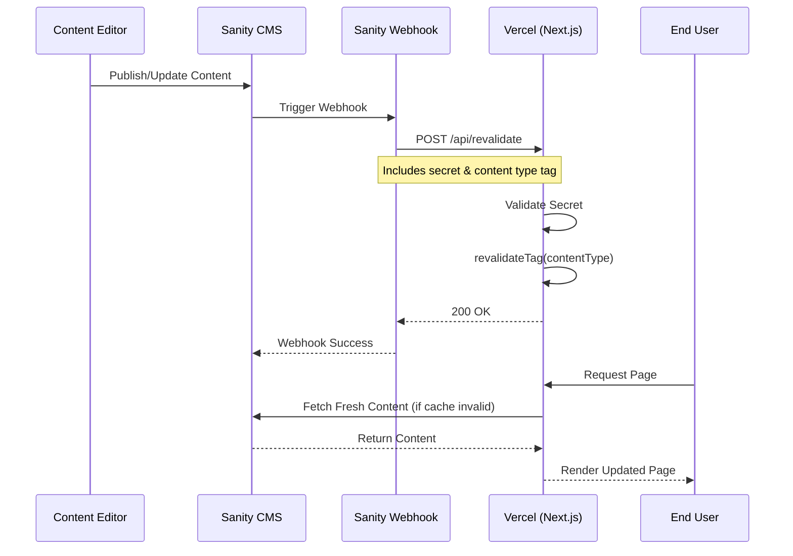

# Developer Portfolio - Cloud Native / SRE Engineer

A modern, clean portfolio website built for backend engineers, SREs, and cloud architects. Features a sophisticated dark theme with subtle animations and a professional layout.

## Tech Stack

- **Framework**: Next.js 16 (App Router)
- **Styling**: Tailwind CSS v4
- **Typography**: Inter (body) + JetBrains Mono (code)
- **Icons**: Lucide React
- **Components**: shadcn/ui

## Project Structure

```
├── app/
│   ├── layout.tsx          # Root layout with fonts and metadata
│   ├── page.tsx            # Main portfolio page
│   ├── globals.css         # Theme colors and global styles
│   └── blog/
│       ├── page.tsx        # Blog listing page
│       └── [slug]/page.tsx # Individual blog post pages
├── components/
│   ├── animated-background.tsx  # Floating nodes background animation
│   ├── header.tsx          # Navigation header
│   ├── hero.tsx            # Hero section with photo and intro
│   ├── about.tsx           # About section with bio and skills
│   ├── experience.tsx      # Work experience timeline
│   ├── projects.tsx        # Featured projects grid
│   ├── certifications.tsx  # Certification badges
│   ├── speaking.tsx        # Conference talks and presentations
│   ├── contact.tsx         # Contact CTA section
│   └── footer.tsx          # Footer with social links
├── lib/
│   └── blog-data.ts        # Blog posts data and content
└── public/
    └── badges/             # Certification badge images
```

## Customization Guide

### 1. Personal Information

#### Hero Section (`components/hero.tsx`)

Update your name, title, and introduction:

```tsx
<h1>Your Name</h1>
<p>Your Title / Role</p>
```

Replace the profile photo by updating the image path or adding your own image to `/public/`.

Update social links (GitHub, LinkedIn, Twitter) with your URLs.

#### About Section (`components/about.tsx`)

Edit the bio paragraphs to describe your background and expertise.

Update the skills array with your technical skills:

```tsx
const skills = [
  "Kubernetes", "Docker", "Terraform", "AWS", "GCP",
  // Add your skills...
]
```

### 2. Experience (`components/experience.tsx`)

Update the `experiences` array with your work history:

```tsx
const experiences = [
  {
    company: "Company Name",
    role: "Your Role",
    period: "2022 - Present",
    description: "What you did and achieved...",
    skills: ["Skill1", "Skill2", "Skill3"]
  },
  // Add more experiences...
]
```

### 3. Projects (`components/projects.tsx`)

Update the `projects` array with your featured work:

```tsx
const projects = [
  {
    title: "Project Name",
    description: "What the project does and your contributions...",
    tech: ["Tech1", "Tech2", "Tech3"],
    github: "https://github.com/username/repo",
    external: "https://project-url.com", // optional live link
    image: "/path-to-screenshot.png" // optional
  },
  // Add more projects...
]
```

### 4. Certifications (`components/certifications.tsx`)

Update the `certifications` array and add your badge images to `/public/badges/`:

```tsx
const certifications = [
  {
    name: "Certification Name",
    issuer: "Issuing Organization",
    date: "2024",
    badge: "/badges/your-badge.png",
    link: "https://verification-url.com"
  },
  // Add more certifications...
]
```

### 5. Speaking Engagements (`components/speaking.tsx`)

Update the `talks` array with your presentations:

```tsx
const talks = [
  {
    title: "Talk Title",
    event: "Conference Name",
    location: "City, Country",
    date: "Month 2024",
    description: "Brief description of the talk...",
    videoLink: "https://youtube.com/...", // optional
    slidesLink: "https://speakerdeck.com/..." // optional
  },
  // Add more talks...
]
```

### 6. Blog Posts (`lib/blog-data.ts`)

Add or edit blog posts in the `blogPosts` array:

```tsx
export const blogPosts: BlogPost[] = [
  {
    slug: "url-friendly-slug",
    title: "Blog Post Title",
    date: "2024-01-15",
    readTime: "8 min read",
    tags: ["Tag1", "Tag2"],
    excerpt: "Brief summary shown in the listing...",
    content: `
# Your Markdown Content

Write your blog post content here using markdown syntax.

## Code Blocks

```yaml
apiVersion: v1
kind: ConfigMap
```
    `
  },
  // Add more posts...
]
```

### 7. Theme Colors (`app/globals.css`)

Adjust the color scheme by modifying CSS variables:

```css
:root {
  --background: 222 47% 6%;      /* Main background */
  --foreground: 210 40% 98%;    /* Primary text */
  --primary: 217 91% 60%;       /* Accent color (blue) */
  --muted: 217 33% 12%;         /* Card backgrounds */
  --border: 217 33% 17%;        /* Border color */
}
```

### 8. Metadata (`app/layout.tsx`)

Update the site metadata for SEO:

```tsx
export const metadata: Metadata = {
  title: "Your Name | Your Title",
  description: "Your professional summary...",
}
```

## Deployment

### Deploy to Vercel (Recommended)

1. Push your code to GitHub
2. Import the repository on [Vercel](https://vercel.com)
3. Deploy with default settings

### Other Platforms

```bash
# Build for production
pnpm build

# Start production server
pnpm start
```

## Deployment to Vercel

### Prerequisites

- A Sanity project created and configured
- A GitHub repository for this codebase
- A Vercel account (free tier works)

### Step-by-Step Deployment

1. **Push to GitHub**
   - Ensure all changes are committed
   - Push to your GitHub repository

2. **Import to Vercel**
   - Go to [vercel.com](https://vercel.com) and sign in
   - Click **Add New Project**
   - Import your GitHub repository
   - Vercel will auto-detect the Next.js configuration

3. **Configure Environment Variables (before deploying)**

   Configure these in Vercel: **Project → Settings → Environment Variables**.

   | Variable | Description | Where to Find |
   |----------|-------------|---------------|
   | `NEXT_PUBLIC_SANITY_PROJECT_ID` | Your Sanity project ID | Sanity dashboard → Project settings |
   | `NEXT_PUBLIC_SANITY_DATASET` | Dataset name (usually `production`) | Sanity dashboard → Datasets |
   | `NEXT_PUBLIC_SANITY_API_VERSION` | API version (e.g., `2024-12-01`) | Use current date or latest stable |
   | `SANITY_API_TOKEN` | Read token for fetching data | Sanity dashboard → API → Tokens (Viewer permissions) |
   | `REVALIDATE_SECRET` | Secret for webhook authentication | Generate using `openssl rand -base64 32` |

   Steps:
   1. Add each variable for **Production**, **Preview**, and **Development**
   2. Redeploy after saving environment variables

4. **Deploy**
   - Click **Deploy** and wait for the build to complete
   - Your site will be live at `https://your-project.vercel.app`

5. **Configure Custom Domain (Optional)**
   - Go to **Project Settings → Domains**
   - Add your custom domain
   - Update DNS records as instructed by Vercel

6. **Set Up Sanity Webhooks (On-Demand Revalidation)**

   In Sanity dashboard:

   - Navigate to `https://www.sanity.io/manage`
   - Go to **API settings → Webhooks**
   - Create a new webhook:
     - **Name**: `Vercel Revalidation`
     - **URL**: `https://your-domain.vercel.app/api/revalidate`
     - **Dataset**: `production` (or your configured dataset)
     - **Trigger on**: Create, Update, Delete
     - **HTTP method**: POST
     - **Include drafts**: No (unless you want draft changes to trigger revalidation)

   Webhook payload/body:

   ```json
   {
     "secret": "{{secrets.REVALIDATE_SECRET}}",
     "tag": "{{_type}}"
   }
   ```

   Add `REVALIDATE_SECRET` to Sanity **secrets** in your project settings, then test the webhook using **Test webhook**.

   **Webhook behavior**: When content is updated in Sanity, it will POST to `/api/revalidate` with the content type as `tag`, triggering Next.js to revalidate cached data for that content type.

### Continuous Deployment

- Vercel automatically deploys on every push to your main branch
- Preview deployments are created for pull requests
- Environment variables are inherited from project settings

### Revalidation Strategy

- Content changes in Sanity trigger automatic revalidation via webhooks
- Blog posts use ISR (Incremental Static Regeneration) with on-demand revalidation
- Homepage and portfolio sections revalidate when their respective content types are updated

### Monitoring and Logs

- View deployment logs in Vercel dashboard → **Deployments**
- Check webhook logs in Sanity dashboard → **API → Webhooks**
- Monitor revalidation requests in Vercel → **Functions** → `/api/revalidate`

### Architecture Diagram



## Troubleshooting

| Issue | Solution |
|-------|----------|
| Webhook returns 401 error | Verify `REVALIDATE_SECRET` matches in both Vercel and Sanity |
| Content not updating after publish | Check webhook logs in Sanity, ensure webhook is active |
| Images not loading | Verify `NEXT_PUBLIC_SANITY_PROJECT_ID` is correct and images are published |
| Build fails on Vercel | Check environment variables are set for all environments |
| Sanity Studio not accessible | Ensure `/studio` route is deployed and CORS is configured in Sanity |

## Local Development

```bash
# Install dependencies
pnpm install

# Run development server
pnpm dev

# Run lint
pnpm lint

# Open http://localhost:3000
```

## Features

- Responsive design (mobile, tablet, desktop)
- Animated background with floating network nodes
- Smooth scroll navigation
- Blog with markdown support and syntax highlighting
- Certification badges display
- Dark theme optimized for readability
- SEO-friendly metadata
- Accessible (semantic HTML, ARIA labels)

## License

MIT License - Feel free to use this template for your own portfolio.
